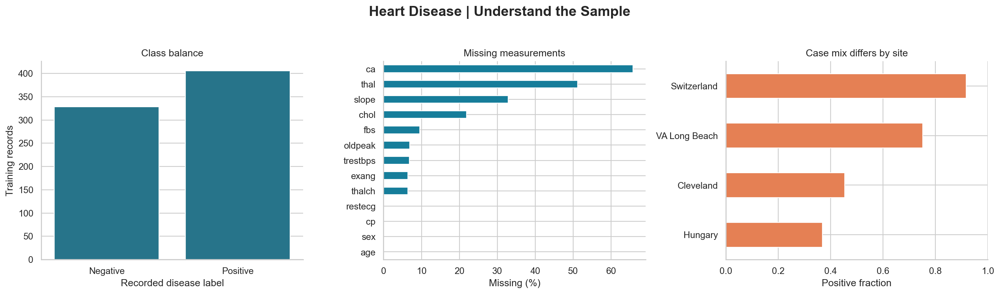
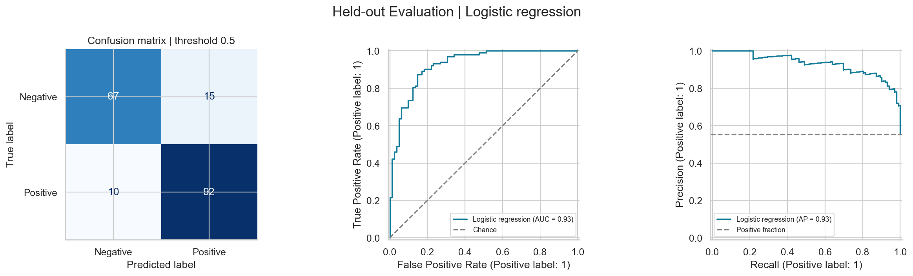

# Heart Disease Data Science | علم داده بیماری قلبی

[English](#english) · [فارسی](#persian)

<a id="english"></a>

## English

**From messy clinical records to reproducible, leakage-aware model evaluation.**

A notebook-first study of a pooled, four-centre heart disease dataset. The project asks whether recorded clinical measurements distinguish a positive diagnosis label, then examines how that result changes across collection sites.

[Explore the executed notebook](heart_disease.ipynb) · [Read the data card](DATA.md) · [Inspect metric tables](reports/)



### What this project demonstrates

- **Data quality:** schema checks, documented duplicate handling, zero-value corrections, and a preserved raw CSV.
- **Exploratory analysis:** missingness by site, clinical distributions, chest-pain comparisons, correlations, and a training-only PCA view.
- **Sound evaluation:** stratified holdout, fold-specific preprocessing, five-fold cross-validation, and a class-prior baseline.
- **Interpretation:** permutation importance, logistic coefficients, uncertainty estimates, and subgroup counts.
- **Reproducibility:** fixed seeds, pinned direct dependencies, an executed notebook, and a GitHub Actions execution check.

### Results

The supplied CSV has **922 rows and 16 columns**. Removing two exact duplicates and two additional identical clinical profiles leaves **918 records**: 734 training and 184 holdout. The extra profile removal is conservative; distinct IDs could represent different people. See [DATA.md](DATA.md).

Model selection uses **training CV ROC-AUC only**, with three predefined candidates and no hyperparameter search:

| Model | CV ROC-AUC, mean ± fold SD | CV average precision | CV balanced accuracy |
|---|---:|---:|---:|
| Logistic regression | **0.888 ± 0.053** | 0.898 | 0.815 |
| Random forest | 0.883 ± 0.054 | 0.886 | 0.815 |
| Class-prior baseline | 0.500 ± 0.000 | 0.553 | 0.500 |

The small CV difference does not establish a statistically meaningful advantage for logistic regression. It wins under the predefined selection rule.

| Selected model: logistic regression | Holdout result |
|---|---:|
| ROC-AUC | **0.926** |
| ROC-AUC bootstrap 95% interval | 0.888–0.959 |
| Average precision | 0.933 |
| Accuracy | 86.4% |
| Recall / sensitivity | 90.2% |
| Specificity | 81.7% |
| F1 | 0.880 |
| Brier score | 0.106 |

At threshold 0.5, the holdout contains **10 false negatives and 15 false positives**. The interval is a stratified percentile bootstrap conditional on the fitted model and holdout class counts; it excludes training and model-selection uncertainty.



**The key limitation is transfer across sites.** A separate training-only leave-one-site-out logistic diagnostic yields ROC-AUC values from **0.684 to 0.903**. The pooled random-split result does not establish performance at a new hospital. Site is excluded as a predictor, but measurement patterns can still act as proxies.

### Method

1. Validate the source schema and diagnosis labels. Apply documented, fixed data-integrity rules.
2. Reserve a stratified 20% holdout with seed 42 before relationship analysis.
3. Explore training data only. Keep sparse fields and clinically extreme values.
4. Build a `ColumnTransformer` inside each model pipeline: median imputation and missingness indicators for numeric fields, standard scaling, and categorical imputation plus one-hot encoding.
5. Compare the baseline, logistic regression, and random forest using the same five stratified folds. Select by mean ROC-AUC.
6. Audit site transfer using training rows, then evaluate the selected pipeline on the holdout once.
7. Report uncertainty, subgroup counts, permutation importance, and limitations without using the diagnostics to retune.

The binary target is `num > 0`. Neither the original diagnosis grade `num`, the identifier `id`, nor the site label `dataset` enters the classifier. Full preprocessing stays inside cross-validation.

### Run locally

Use **Python 3.11**. From the repository root on Windows PowerShell:

```powershell
python -m venv .venv
.venv\Scripts\python -m pip install -r requirements.txt
.venv\Scripts\python -m jupyterlab
```

Open `heart_disease.ipynb`, select the environment's Python kernel, and run all cells in order. On macOS/Linux, use `.venv/bin/python` in place of `.venv\Scripts\python`.

To validate and execute from a clean kernel without opening Jupyter:

```powershell
.venv\Scripts\python scripts/validate_notebook.py
```

The check validates notebook structure and executes every code cell in a clean kernel and temporary working directory containing only a copy of the raw CSV. It runs the notebook's integrity assertions, requires nine newly generated, nonempty reports, and then saves the reports and executed notebook back to the project. Existing reports cannot satisfy this check. It fails on execution errors. GitHub Actions runs the same command on Python 3.11. Direct dependencies are pinned; transitive dependencies and platform differences may affect exact reproducibility.

### Repository

```text
heart_disease.ipynb             One canonical notebook, with executed outputs
heart_disease_uci.csv           Original supplied CSV, unchanged
DATA.md                        Source attribution, schema, assumptions, limits
requirements.txt               Pinned direct dependencies
reports/                       Generated figures and metric tables
scripts/validate_notebook.py    Clean-kernel execution check
.github/workflows/notebook.yml  GitHub Actions validation
```

The notebook regenerates `reports/` outputs. It does not export a globally imputed dataset or a deployable medical model. The earlier two working notebooks were consolidated into this single analysis; their local backups are outside the repository.

### Data attribution and responsible interpretation

Original dataset: [UCI Heart Disease](https://archive.ics.uci.edu/dataset/45/heart+disease), DOI [10.24432/C52P4X](https://doi.org/10.24432/C52P4X), credited to Andras Janosi, William Steinbrunn, Matthias Pfisterer, and Robert Detrano. UCI lists its dataset under [CC BY 4.0](https://creativecommons.org/licenses/by/4.0/). The included CSV is a transformed version with an undocumented download history; [DATA.md](DATA.md) records that distinction and its fingerprint.

This study classifies an existing diagnosis label. It does **not** forecast future cardiovascular risk. Historical sampling, unequal subgroup representation, sparse diagnostic measurements, and site differences limit generalisation. Clinical deployment would require independent contemporary validation, a defined use case, and calibration and threshold assessment.

No software licence has been selected for this repository. The dataset attribution above does not license the project code.

---

<a id="persian"></a>

## فارسی

**از بررسی کیفیت داده‌های بالینی تا ارزیابی تکرارپذیر مدل با پیشگیری از نشت داده.**

این پروژه با یک نوت‌بوک اصلی، داده‌های بیماری قلبی از چهار مرکز را تحلیل می‌کند. پرسش پروژه این است: آیا اندازه‌گیری‌های بالینی ثبت‌شده می‌توانند برچسب تشخیص مثبت بیماری را از برچسب منفی تفکیک کنند؟ سپس تفاوت عملکرد بین مراکز بررسی می‌شود.

[نوت‌بوک اجراشده](heart_disease.ipynb) · [شناسنامه و فرهنگ داده‌ها](DATA.md) · [جدول نتایج و نمودارها](reports/)

### مهارت‌ها و مراحل پروژه

- **کیفیت داده:** کنترل ساختار ستون‌ها، بررسی ردیف‌های تکراری، اصلاح صفرهای نامعتبر و حفظ CSV اولیه.
- **تحلیل اکتشافی:** بررسی مقادیر گمشده در مراکز، توزیع ویژگی‌ها، مقایسه انواع درد قفسه سینه، همبستگی و نمایش PCA روی داده‌های آموزش.
- **مدل‌سازی:** مقایسه رگرسیون لجستیک، جنگل تصادفی و مدل مبنا با اعتبارسنجی متقاطع پنج‌بخشی.
- **ارزیابی و تفسیر:** ماتریس درهم‌ریختگی، منحنی ROC و Precision–Recall، اهمیت ویژگی با جایگشت، ضرایب مدل و بررسی زیرگروه‌ها.
- **تکرارپذیری:** بذر تصادفی ثابت، نسخه مشخص وابستگی‌های مستقیم، خروجی‌های ذخیره‌شده و اجرای خودکار نوت‌بوک در GitHub Actions.

### داده‌ها و تصمیم‌های پاک‌سازی

CSV اولیه **۹۲۲ ردیف و ۱۶ ستون** دارد. دو ردیف کاملاً تکراری و دو پروفایل بالینی یکسان دیگر با نادیده‌گرفتن شناسه حذف می‌شوند؛ **۹۱۸ رکورد** باقی می‌ماند. حذف دو پروفایل اخیر یک تصمیم محافظه‌کارانه برای جلوگیری از عبور نمونه‌های یکسان به دو بخش آموزش و تست است؛ شناسه‌های متفاوت ممکن است متعلق به افراد متفاوت باشند.

صفرهای فشار خون و کلسترول به مقدار گمشده تبدیل می‌شوند. مقادیر منفی `oldpeak`، مقادیر بالای بالینی و ستون‌های دارای داده گمشده زیاد به‌صورت خودکار حذف نمی‌شوند. CSV اصلی بازنویسی نمی‌شود. جزئیات و اثرانگشت فایل در [DATA.md](DATA.md) آمده است.

هدف دودویی برابر `num > 0` است. درجه تشخیص `num`، شناسه `id` و نام مرکز `dataset` وارد ویژگی‌های مدل نمی‌شوند.

### روش جلوگیری از نشت داده

۱. پیش از بررسی روابط و یادگیری تبدیل‌ها، ۲۰٪ داده با حفظ نسبت کلاس‌ها و بذر ۴۲ برای تست کنار گذاشته می‌شود: **۷۳۴ رکورد آموزش و ۱۸۴ رکورد تست**.

۲. تحلیل اکتشافی، PCA و مقایسه مدل‌ها فقط روی داده‌های آموزش انجام می‌شوند.

۳. جای‌گذاری با میانه و افزودن نشانگر مقادیر گمشده برای ویژگی‌های عددی، استانداردسازی و تبدیل ویژگی‌های دسته‌ای داخل `Pipeline` و `ColumnTransformer` قرار دارند. این مراحل در هر بخش اعتبارسنجی فقط با نمونه‌های آموزش همان بخش برازش می‌شوند.

۴. مدل با بیشترین میانگین ROC-AUC در اعتبارسنجی آموزش انتخاب می‌شود. جست‌وجوی ابرپارامتر یا تنظیم آستانه بر اساس تست انجام نمی‌شود.

۵. انتقال بین مراکز روی بخش آموزش بررسی می‌شود؛ سپس مدل منتخب با آستانه پیش‌فرض ۰٫۵ روی تست ارزیابی می‌شود. نتایج تشخیصی بعدی برای تنظیم مجدد مدل استفاده نمی‌شوند.

### نتایج

| مدل | میانگین ROC-AUC اعتبارسنجی ± انحراف معیار بخش‌ها | Average precision | Balanced accuracy |
|---|---:|---:|---:|
| رگرسیون لجستیک | **0.888 ± 0.053** | 0.898 | 0.815 |
| جنگل تصادفی | 0.883 ± 0.054 | 0.886 | 0.815 |
| مدل مبنا بر اساس نسبت کلاس‌ها | 0.500 ± 0.000 | 0.553 | 0.500 |

اختلاف کوچک دو مدل یادگیرنده، برتری آماری رگرسیون لجستیک را اثبات نمی‌کند؛ این مدل مطابق معیار از پیش مشخص‌شده انتخاب شده است.

| معیار مدل منتخب روی تست | مقدار |
|---|---:|
| ROC-AUC | **0.926** |
| بازه ۹۵٪ بوت‌استرپ ROC-AUC | 0.888–0.959 |
| Average precision | 0.933 |
| دقت | 86.4% |
| حساسیت؛ سهم موارد مثبت شناسایی‌شده | 90.2% |
| ویژگی؛ سهم موارد منفی درست شناسایی‌شده | 81.7% |
| F1 | 0.880 |
| امتیاز Brier | 0.106 |

در آستانه ۰٫۵، **۱۰ منفی کاذب و ۱۵ مثبت کاذب** ثبت شده است. بازه بوت‌استرپ با ۱۰۰۰ بازنمونه‌گیری طبقه‌بندی‌شده از تست محاسبه می‌شود؛ عدم قطعیت ناشی از آموزش و انتخاب مدل را پوشش نمی‌دهد. انحراف معیار بخش‌های اعتبارسنجی نیز بازه اطمینان نیست.

**محدودیت اصلی، انتقال به مرکز جدید است.** در آزمون جداگانه رگرسیون لجستیک، هر بار یک مرکز از بخش آموزش برای ارزیابی کنار گذاشته می‌شود. ROC-AUC این آزمون بین **0.684 و 0.903** است؛ نتیجه خوب تقسیم تصادفی را نمی‌توان به بیمارستانی جدید تعمیم داد. حتی بدون ستون مرکز، الگوی اندازه‌گیری و مقادیر گمشده ممکن است اطلاعات مرکز را منتقل کند.

نمودارهای خلاصه داده‌ها و ارزیابی در بخش انگلیسی همین فایل نمایش داده شده‌اند. تمام جدول‌ها و تصویرهای خروجی در [reports](reports/) در دسترس‌اند.

### اجرای پروژه

از **Python 3.11** استفاده کنید. فرمان‌های زیر را در ریشه پروژه و در PowerShell اجرا کنید:

```powershell
python -m venv .venv
.venv\Scripts\python -m pip install -r requirements.txt
.venv\Scripts\python -m jupyterlab
```

فایل `heart_disease.ipynb` را باز کنید، کرنل محیط مجازی را انتخاب کنید و همه سلول‌ها را به‌ترتیب اجرا کنید. در لینوکس و macOS، مسیر `.venv/bin/python` جایگزین `.venv\Scripts\python` می‌شود.

برای کنترل ساختار و اجرای کامل با کرنل تازه، بدون بازکردن Jupyter:

```powershell
.venv\Scripts\python scripts/validate_notebook.py
```

این بررسی در پوشه موقت و با یک کپی از CSV اجرا می‌شود؛ وجود فایل‌های خروجی قبلی کافی نیست. هر ۹ گزارش باید در همان اجرا تولید شده و غیرخالی باشند. پس از موفقیت، گزارش‌ها و نوت‌بوک اجراشده ذخیره می‌شوند. خطای اجرای سلول‌ها باعث شکست بررسی می‌شود. نسخه وابستگی‌های مستقیم ثابت است؛ تفاوت سیستم‌عامل و وابستگی‌های غیرمستقیم ممکن است روی تکرار دقیق نتیجه اثر بگذارد.

### ساختار فایل‌ها

| مسیر | کاربرد |
|---|---|
| `heart_disease.ipynb` | تنها نوت‌بوک اصلی، همراه خروجی اجرا |
| `heart_disease_uci.csv` | CSV اولیه بدون تغییر |
| `DATA.md` | منبع، فرهنگ داده، فرض‌های پاک‌سازی و محدودیت‌ها |
| `requirements.txt` | نسخه وابستگی‌های مستقیم |
| `reports/` | نمودارها و جدول‌های تولیدشده |
| `scripts/validate_notebook.py` | بررسی و اجرای کامل نوت‌بوک |
| `.github/workflows/notebook.yml` | بررسی خودکار در گیت‌هاب |

### منبع و محدودیت کاربرد

منبع اصلی، [UCI Heart Disease](https://archive.ics.uci.edu/dataset/45/heart+disease) با شناسه [10.24432/C52P4X](https://doi.org/10.24432/C52P4X) است. UCI نام Andras Janosi، William Steinbrunn، Matthias Pfisterer و Robert Detrano را به‌عنوان پدیدآورندگان ذکر کرده و داده خود را با مجوز [CC BY 4.0](https://creativecommons.org/licenses/by/4.0/) ارائه می‌کند. فایل موجود یک نسخه تبدیل‌شده است؛ تاریخچه دقیق دریافت و تبدیل آن ثبت نشده است.

این پروژه برچسب تشخیص موجود را طبقه‌بندی می‌کند؛ پیش‌بینی خطر بیماری در آینده نیست. برخی ورودی‌ها حاصل بررسی‌های تشخیصی هستند. داده‌های تاریخی، ترکیب متفاوت مراکز، توزیع نامتوازن جنسیت و کمبود بعضی اندازه‌گیری‌ها، تعمیم نتایج را محدود می‌کنند. همبستگی و ضرایب مدل رابطه علت‌ومعلولی را اثبات نمی‌کنند و جدول زیرگروه‌ها اثبات برابری عملکرد نیست.

**پروژه برای آموزش و نمایش مهارت‌های علم داده است؛ اعتبارسنجی بالینی ندارد.** استفاده بالینی به داده مستقل و معاصر، تعریف کاربرد، بررسی کالیبراسیون و انتخاب آستانه مناسب نیاز دارد. هنوز مجوزی برای کد پروژه انتخاب نشده است؛ مجوز داده‌ها به‌معنای مجوز کد نیست.
